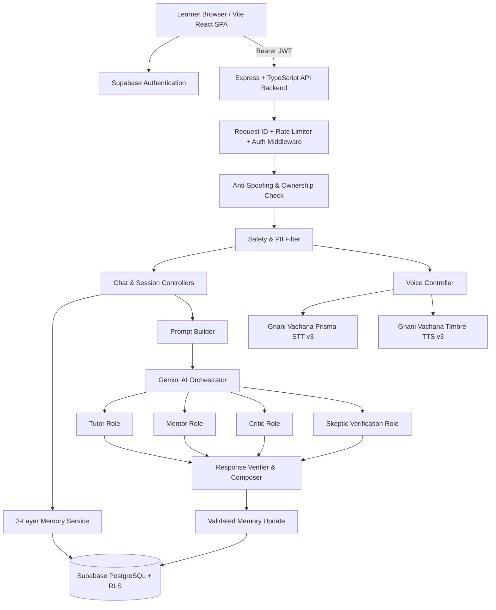

# Guru Mind — System Architecture

Guru Mind is an AI-powered personal language tutor and mentor platform that combines structured diagnostic language teaching (**Gemini AI**) with natural Indian-accent and multilingual voice interaction (**Gnani AI / Vachana**), backed by **Supabase PostgreSQL**, **Supabase Auth**, and **Row Level Security (RLS)**.

## 1. High-Level System Diagram

## 2. Two-API-Key Dual-Engine Design

All provider keys remain strictly server-side in `backend/src/config/environment.ts` and are never exposed to `VITE_*` client variables.

| Engine | Provider | Key | Responsibilities |
| :--- | :--- | :--- | :--- |
| Reasoning & Pedagogical Intelligence | Google Gemini AI (`@google/genai`) | `GEMINI_API_KEY` | Inner Council orchestration (Tutor, Mentor, Critic, Skeptic, Response Composer), structured corrections (*Jo sahi tha*, *Sahi version*, *Kyun galat tha*), end-of-session reviews, adaptive MCQs. |
| Speech & Natural Voice | Gnani AI / Vachana REST APIs | `GNANI_API_KEY` | Multilingual Indian speech recognition (`POST /stt/v3`, `prisma-v3.0`) including code-mixed Hinglish (`indic-auto`), and natural Indian voice playback (`POST /api/v1/tts/inference`, `timbre-v3.0`, e.g., `Shivani`, `Devansh`, `Riyaa`, `Prakash`). Graceful Web Speech API fallback when unconfigured. |

## 3. Core Learning Loop

Every message follows:

`Observe -> Diagnose -> Teach -> Test -> Update`

1. **Authenticate & Authorize**: Verify Supabase JWT via `authenticate.ts` and reject body/query `user_id` spoofing via `authorize.ts`.
2. **Safety & Privacy Filter**: Redact accidental passwords, API keys, credit cards, PAN, Aadhaar, or SSN patterns before prompt construction or database storage (`safetyFilter.ts`).
3. **Session & Memory Retrieval**: Load the active session (or open one for the mode), plus bounded records across the three separate memory layers (`memoryService.ts`).
4. **Prompt Building & Inner Council**: Build a personalized prompt containing profile metadata, weak concepts, top Mistake Fingerprint patterns, recent Constant Notes, and bounded conversation history (`promptBuilder.ts`), then call Gemini with strict JSON Schema (`aiOrchestrator.ts`). Optional second-pass Skeptic verification can be enabled via `ENABLE_SKEPTIC_SECOND_PASS=true`.
5. **Deterministic Response Verification**: Validate Zod schema, deduplicate corrections, strip no-op corrections (`original === corrected`), cap at 2 corrections unless full correction was requested, clamp confidence bounds, and sanitize text (`responseVerifier.ts`).
6. **Conditional Persistence & Memory Update**: Respect `profiles.save_history`; persist user/assistant messages, record verified `mistakes`, increment `mistake_patterns`, smoothly blend confidence scores in `learner_concepts`, and append safe non-duplicate `constant_notes`.

## 4. Separation of Memory Layers

Guru Mind deliberately separates memory so raw chat logs never corrupt cumulative notes or mastery tracking:

1. **Raw History (`messages`, `learning_sessions`)**: Exact chronological conversation trace, mode, corrections, and session summaries.
2. **Constant Notes (`constant_notes`, `memory_cards`)**: Append-friendly durable takeaways and versioned compact learner snapshots.
3. **Learner Model (`learner_concepts`)**: Rolling concept mastery (`known`, `weak`, `unknown`), smoothed `confidence` (`0.000` to `1.000`), error count, confusion notes, and spaced-repetition `next_review_at`.
4. **Mistake Fingerprint (`mistakes`, `mistake_patterns`)**: Individual observations linked to recurring root-cause patterns (e.g., `"Hindi word-order transfer"`, `"mixing 'am' with present simple"`).

