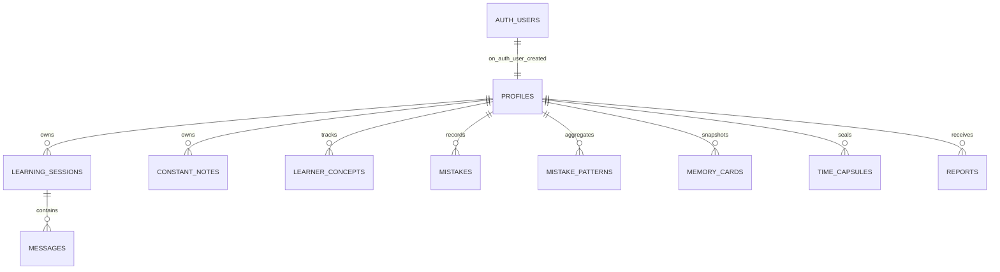

# Guru Mind — Database Architecture

Guru Mind uses **PostgreSQL via Supabase** with UUID primary keys, strict foreign-key ownership, automatic `updated_at` triggers, a signup profile trigger, and **Row Level Security (RLS)** on every user-owned table.

## 1. Entity Relationship Diagram

## 2. Tables Overview

| Table | Purpose | Key Columns & Constraints |
| :--- | :--- | :--- |
| `profiles` | Learner identity & preferences linked 1:1 to `auth.users(id)` | `id`, `full_name`, `native_language`, `learning_language`, `level`, `goal`, `explain_language`, `voice_preference`, `save_history` |
| `learning_sessions` | Tutor & Mentor sessions + end-of-session outcomes | `id`, `user_id`, `mode`, `language`, `title`, `summary`, `homework`, `next_guidance`, `started_at`, `ended_at` |
| `messages` | Raw History (immutable turn log) | `id`, `session_id`, `user_id`, `role`, `content`, `mode`, `jo_sahi_tha`, `corrections` (`jsonb`), `next_question` |
| `constant_notes` | Cumulative learning rules & takeaways | `id`, `user_id`, `language`, `tag`, `title`, `content`, `source_session_id` |
| `learner_concepts` | Concept mastery & spaced repetition state | `id`, `user_id`, `language`, `concept`, `status` (`known`\|`weak`\|`unknown`), `confidence`, `error_count`, `next_review_at` |
| `mistakes` | Individual mistake records (Mistake Museum) | `id`, `user_id`, `session_id`, `message_id`, `original_text`, `corrected_text`, `explanation`, `category`, `root_cause`, `concept` |
| `mistake_patterns` | Aggregated Mistake Fingerprint | `id`, `user_id`, `language`, `pattern_key`, `category`, `root_cause`, `occurrence_count`, `practice_status` |
| `memory_cards` | Versioned compact snapshots per language | `id`, `user_id`, `language`, `version`, `card_content` (`jsonb`) |
| `time_capsules` | Sealed future review notes | `id`, `user_id`, `content`, `target_language`, `reminder_at`, `opened_at` |
| `reports` | End-of-session & weekly report snapshots | `id`, `user_id`, `report_type`, `period_start`, `period_end`, `summary` (`jsonb`) |

## 3. Row Level Security & Isolation

Defined in `database/policies.sql` and included in `database/migrations/0001_initial_schema.sql`:

- RLS is enabled (`ENABLE ROW LEVEL SECURITY`) on all 10 tables.
- Every query runs using a request-scoped Supabase client initialized with the caller's verified JWT (`createUserSupabaseClient`), so PostgreSQL enforces `auth.uid() = id` / `auth.uid() = user_id` in addition to Express ownership checks.
- Inserting into `messages` additionally verifies parent session ownership via `EXISTS (SELECT 1 FROM public.learning_sessions s WHERE s.id = session_id AND s.user_id = auth.uid())`.
- `SUPABASE_SERVICE_ROLE_KEY` is used solely for server-side account deletion (`DELETE /api/privacy/account`).

## 4. Provisioning Database in Supabase

Run the complete migration script `database/migrations/0001_initial_schema.sql` once inside the **Supabase Dashboard -> SQL Editor**.
(Alternatively run `database/schema.sql` followed by `database/policies.sql`.)

